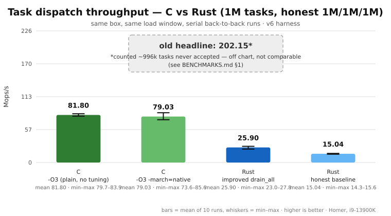
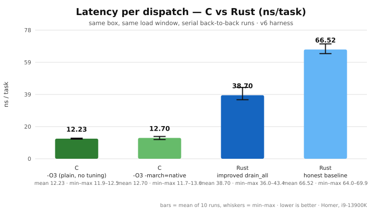

# Rust Is Not All It's Cracked Up to Be — Here Is C Without Extra Tuning

Same box (Homer, i9-13900K). Same workload (1,000,000 no-op tasks through a
4096-slot executor, batches of 1024, single thread, pinned to core 0). Same
honest contract (`attempted == accepted == completed == 1,000,000`, every
run, or it doesn't count). The C version got plain `gcc -O3` — no PGO, no
hand SIMD, no allocator tricks, no tuning whatsoever. And `-march=native`
bought it nothing, which tells you everything about where the time goes.

(Graphs generated from `perf_c.csv` and `perf_h324_normal.csv` by
`svg/make_graphs.py` — bars are 10-run means, whiskers are min–max. No
hand-typed numbers.)

## The numbers

| implementation | mean Mops/s | mean ns/task | min–max Mops/s |
|---|---|---|---|
| C, `gcc -O3` | **81.80** | **12.23** | 79.74 – 83.89 |
| C, `gcc -O3 -march=native` | 79.03 | 12.70 | 73.62 – 85.58 |
| Rust, improved `drain_all` | 25.90 | 38.70 | 23.05 – 27.82 |
| Rust, honest baseline | 15.04 | 66.52 | 14.31 – 15.62 |
| old headline ("202.15") | phantom | — | counted ~996k tasks never accepted |

Plain C with zero tuning dispatches empty tasks **~3.2x faster than the
improved Rust executor and ~5.4x faster than its honest baseline** — on the
same machine, in the same load window, run back-to-back.

## Why Rust loses this one

The C port (`c-executor/task_bench.c`) is a bare dispatch loop: pop a free
slot, `malloc` a 16-byte task, push it on a ring, then pop, indirect-call,
`free`, recycle. The Rust executor does all of that *plus*, per task: waker
construction, `Context` setup, dynamic-dispatch `poll`, `Option`/`VecDeque`
bookkeeping, generation counters, a thread-local guard, and (amortized) an
`io_uring` submit — plus pinning guarantees and a real Pending/wake model
the C code simply doesn't have. That machinery costs **~26 ns per empty
dispatch**, measured, not theorized (38.70 − 12.23).

Two things the graphs also prove, free of charge:

1. **`-march=native` is not magic.** It did nothing for the C loop (79.03
   vs 81.80, noisier) and ~nothing for the Rust loop either. Pointer
   chasing and syscalls don't vectorize. Anyone selling you compiler flags
   for this kind of workload is selling you nothing.
2. **Hugepages didn't matter either** (15.40 → 15.04 across 57 → 324
   pages). The workload is pure heap. Tune what you measured, not what
   sounds fast.

## The honest footnote (read before quoting us)

The ~26 ns gap is *constant per-dispatch overhead*. Constants vanish into
real work: a task body costing 1 µs runs ~1012 ns in C vs ~1039 ns in
Rust — under 3% apart, before Rust's safety buys you anything. So the
claim is precisely this wide: **for sub-100 ns dispatch loops, hand-rolled
C still rules, no tuning required** — and Rust's async abstraction has a
metered price tag of about two dozen nanoseconds per empty task. The C
loop has no futures, no wakers, no Pending path, no thread-local guard, no
uring integration, and no memory-safety net. Pick the tool with eyes open:
speed where it counts, abstraction where it pays. What you can't do any
more is pretend the abstraction is free — we measured it.

Source: `c-executor/` · method: `BENCHMARKS.md` · raw runs: `perf_c.csv`,
`perf_h324_normal.csv` · machine context: `PERFORMANCE.md` §3.
